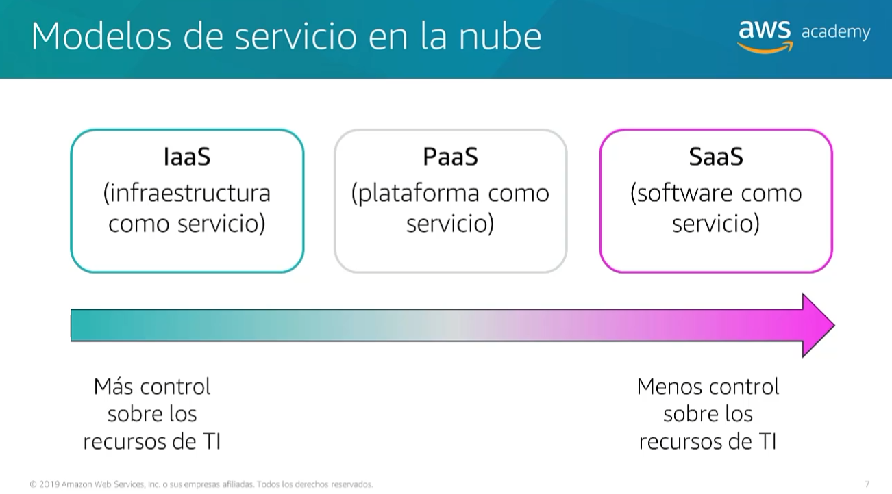
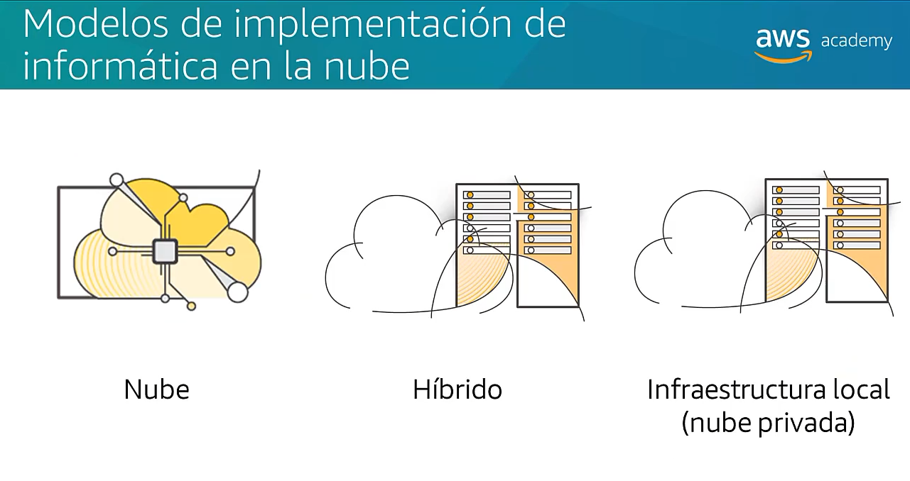
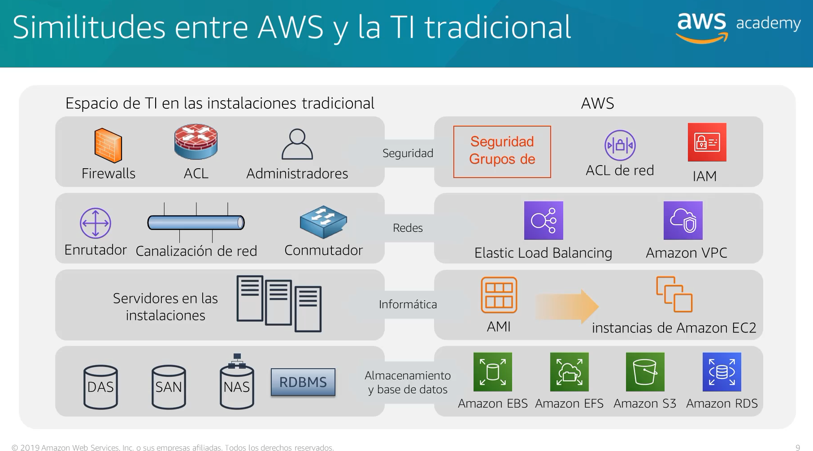

# Introducción a la computación en la nube. 
La informática en la nube (cloud computing) es la entrega bajo demanda de recursos de cómputo como bases de datos, almacenamiento, aplicaciones, entre otros recursos de TI. Todo a través de internet con un sistema de precios de pago por uso. Estos recursos se ejecutan en servidores en grandes centros de datos en diferentes partes del mundo. 

La informática en la nube permite dejar de considerar la infraestructura como hardware y, en cambio, verla y usarla como software. Un modelo de informática tradicional requiere espacio, personal, seguridad física, planificación e inversión de capital que es bastante caro. En contraste, la computación en la nube permite ver la **infraestructura como un software**. 

Las soluciones de software son flexibles, pueden cambiar de forma rápida, sencilla y rentable. Solo se paga por lo que se usa y cuando se usa, además, puede expandirse o contraerse de acuerdo a la necesidad del cliente, es decir, podemos tomar los recursos de hardware como temporales y desechables. De esta manera, la computación en la nube **es la solución** a todos aquellos problemas de hardware: evita tareas difíciles como aprovisionamiento, mantenimiento, y planificación de capacidad, así como también permite concentrarse en lo que en verdad importa dentro de la empresa. 

Así como la computación en la nube ha evolucionado se han desarrollado diversos modelos de servicio y estrategia de implementación ayudando a satisfacer las necesidades específicas de los usuarios. Comprender las diferencias entre estos modelos de servicios en la nube y las estrategias de implmentación puede ayudar a decidir que conjunto de servicios son los adecuados para las necesidades. 

## Modelos de sevicio en la nube

Las tres son formas de usar la nube. Lo que cambia es cuánto administras tú y cuánto administra el proveedor(AWS).

### 1. Iaas (Infraestructura como servicio)
Construye los bloques de creación de la computación en la nube, por lo general proporciona acceso a características de redes, equipos virtuales o dedicados además de espacio de almacenamiento. Ofrece el mayor nivel de flexibilidad y control sobre recursos de TI. Ofrece acceso bajo demanda o recursos informáticos. La persona que contrata tiene el control total y responsablidad de instalar, configurar y mantener el sistema operativo, bases de datos y aplicaciones. 

Tú administras: sistema operativo, parches, runtime, aplicación y datos.
AWS administra: hardware físico, data center, red y virtualización.

Ejemplos en AWS: Amazon EC2, Amazon VPC, Amazon EBS.

MAXIMO CONTROL Y MÁXIMA RESPONSABILIDAD. 

### 2. Paas (Plataforma como servicio)
Permite administrar la infraestructura subyascente. Normalmente esto se refiere al hardware y al sistema operativo. Lo hace a través de automatización y administración de sus aplicaciones en lugar de su aprovisionamiento. Es decir, es un espacio listo para crear, probar, desplegar y gestionar apps. El desarrollador solo se preocupa por escribir código y gestionar la app. Elimina todas las necesidades de preocuparse de confidurar hardware o mantener el sistema operativo. 

Tú administras: tu aplicación y tus datos.
AWS administra: infraestructura, sistema operativo, parches, runtime y escalado.

Ejemplos en AWS: AWS Elastic Beanstalk, Amazon RDS (te da la base de datos sin que gestiones el servidor), AWS Lambda (se suele ubicar aquí o como “serverless”).

TE ENFOCAS EN EL CÓDIGO, NO EN LOS SERVIDORES

### 3. Saas (Software como servicio)
Proporciona un producto completo que el proveedor de servicio ejecuta y administra. Normalmente son las aplicaciones del usuario final, acá no hay que configurar ni mantener nada, todo el producto desde el servidor hasta la interfaz visual es gestionada por el proveedor y el usuario del software comos servicio solo accede a el mendiante un navegador web o una app movil.

Tú administras: solo tu uso y tus datos dentro de la app (usuarios, configuración).
El proveedor administra: todo lo demás.

Ejemplos: Gmail, Microsoft 365, Zoom, Salesforce. En AWS: Amazon WorkMail y Amazon Chime.

Caso: abres Gmail y envías un correo. No sabes ni te importa en qué servidor corre.

CERO ADMINISTRACIÓN Y MÍNIMO CONTROL. 

En conclusión, cuanto más subes de IaaS a SaaS, más responsabilidad pasa a AWS.

## Modelos de implementación de informática en la nube

Son 3 los modelos de implementación y cada uno de ellos representa el entorno de la nube en que se pueden implmentar nuestras aplicaciones. 

### 1. Nube 
Una aplicación basada en la nube está totalmente implementada en la nube, es decir, todas las partes de la app se ejecutan en la nube y se han creado directamente en la nube o se han transferido desde una infraestructura existente. Sus aplicaciones pueden crearse sobre partes de infraestructura de bajo nivel. 

Ejemplo: Una startup crea su aplicación en la nube y no tiene servidor, pues tambíen lo crea ahí entonces será todo en nube. Notese que un servidor no es una aplicación y por eso no es un SaaS. 

### 2. Híbrido
Una implmentación híbrida se basa en que se conecta la infraestrcutura y las aplicaciones existentes a los recursos basados en la nube. Básicamente conecta los recursos de la nube con nuestros sistemas internos. 

Ejemplo: Una empresa mantiene sus servidores en su data center, pero los conecta con AWS para guardar copias de seguridad. Combinar infraestructura propia con recursos en la nube, conectados entre sí, es el modelo híbrido.

### 3. Nube privada
Se recurre a ella por su capacidad de proporcionar recursos dedicados. La infraestructrua esta en mi propio data center y usa herramientas de virtualización y gestión de recursos para tener algo parecido a la nube, pero solo para mi organización. Requiere muchisima inversión inicial.  

Ejemplo: Un banco usa herramientas de virtualización en su propio data center para administrar recursos solo para su organización.Virtualización en el propio data center, sin la nube pública, es on-premises, también llamado nube privada.\\

$\rightarrow$ Modelo de servicio (IaaS, PaaS, SaaS) responde ¿qué te da el proveedor y qué administras tú?\\

$\rightarrow$ Modelo de implementación (nube, híbrido, on-premises) responde ¿dónde están tus recursos?

## Similitudes entre AWS y la TI tradicional

Por ello casi todo lo que se puede necesitar de un centro de datos tradicional se encuentra dentro de AWS. 