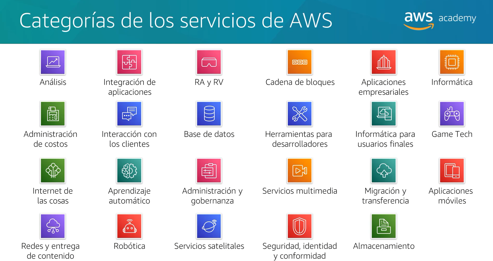
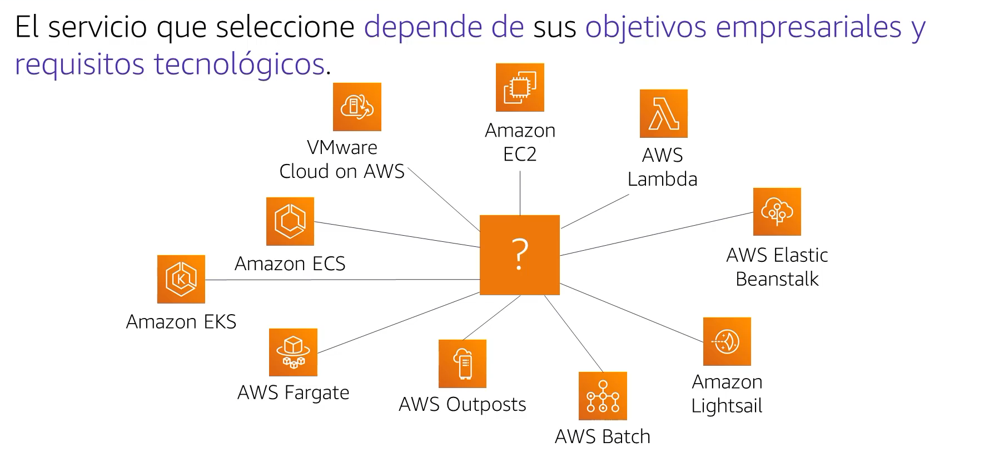
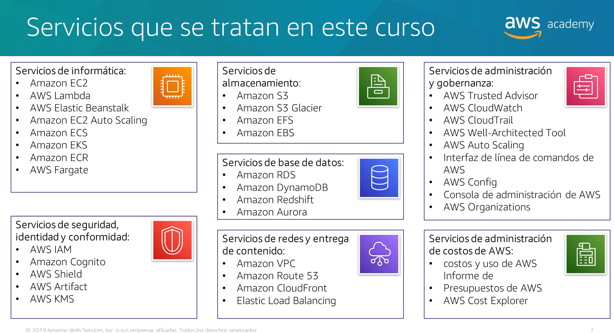

# Introducción a AWS

## ¿Qué son los servicios web?
Un servicio web es cualquier software que esta disponible a través de internet y usa un formato estandarizado (como el lenguaje de marcado extensible XML o la notación de objetos en javascript JSON) para la solicitud y la respuesta de una interacción con la interfaz de programación de aplicaciones (API).

Sus características principales:

* Se accede por Internet (normalmente por HTTP o HTTPS).
*Expone una API, es decir, un conjunto definido de operaciones que otros programas pueden invocar.
* Usa formatos estándar (JSON o XML), por lo que lo puede usar cualquier sistema, sin * importar el lenguaje o la plataforma.
* Es de máquina a máquina: está pensado para que un programa se comunique con otro, no para que una persona lo use directamente.

## ¿Qué es AWS?
AWS es una plataformaen la nube segura que ofrece un amplio conjunto de productos o ecosistemas de servicios web, normalmente a traves de internet. 
* AWS le proporciona acceso bajo demanda a recursos informáticos, de almacenamiento, de red, de base de datos y otros recursos de TI y herramientas de adminístración. 
* AWS ofrece flexiblidad. 
* Solo paga por los servicios indivuales que necesita, en la medida en que los utilice. 
* Los servicios de AWS trabajan en conjunto como piezas fundamentales. 

De esta manera la facturación por AWS se convierte en un gasto operativo en lugar de una inversión de capital (usar por lo que se usa, cuando se usa como los servicios públicos). Además, se puede pensar en estos servicios como bloques de creación que se encadenan e interconectan rápidamente  para poder ensamblarse rápidamente y crear soluciones y luego poder cambiarlas según las necesidades. 

## Categorías de AWS: 

Los servicios de AWS se clasifican en diferentes categorías y cada categoría contiene uno o más servicios. El servicio a elegir dependerá de los objetivos empresariales y requisitos tecnológicos de nuestra aplicación. Algunas opciones de cómputo que se pueden elegir para cubrir nuestras necesidades son: 

* Amazon EC2 para control total sobre infraestructura y recursos informáticos de AWS (IaaS).
* AWS lambda cuando se desee ejecutar código sin tener que administrar ni aprovisionar servidores (PaaS). 
* AWS Elastic Beanstalk permite aprovisionar un servicio que luego implementa, administra y escala automáticamente sus aplicaciones web.
* Amazon Ligthsail es una plataforma en la nube para una aplicación web simple que se puede usar cuando solo se desee lanzar una aplicaión web de forma sencilla. 
* AWS batch cuando ejecute cientos de cargas de trabajo por lotes se tenga que hacer de forma fiagle. 
* AWS Outposts cuando se desee ejecutar la infraestructura de AWS en su propio centro de datos. 
* Amazon Elastic Container Service, Amazon Elastic Kubernetes Service o AWS Fargate si se desea implementar arquitectura de contenedores o microservicios.
* VMware Cloud on AWS cuando se teng una plataforma de virtualización se servidolres en las instalaciones que desee migrar a AWS. 
* Entre muchos otros

La variedad de servicios puede resultar intimidante, lo que se tratan en este curso son: 

## ¿Cómo interactuar con AWS?
Hay 3 formas principales con las que se puede interactura con AWS. 

1. Consola de adminstración de AWS, que es una interfaz gráfica fácil de usar a través de un navegador web para la mayoría de servicios.  

2. Interfaz de línea de comandos (AWS CLI): Acceso a los servicios mediante comandos discretos o scripts. Usando cualquier sistema operativo. 

3. kits de desarrollo de software (SDK): Acceso a los servicios directamente desde código (como java, python, etc)
